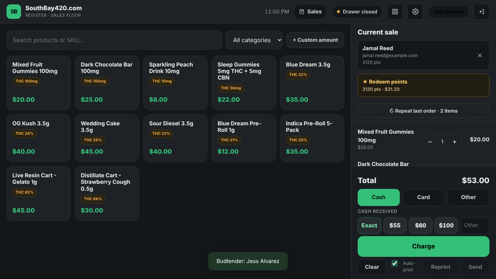
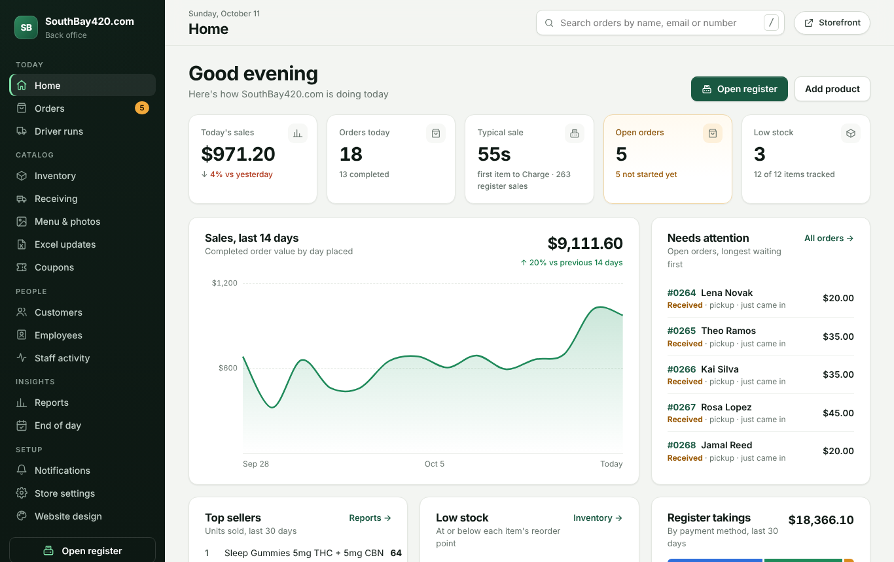
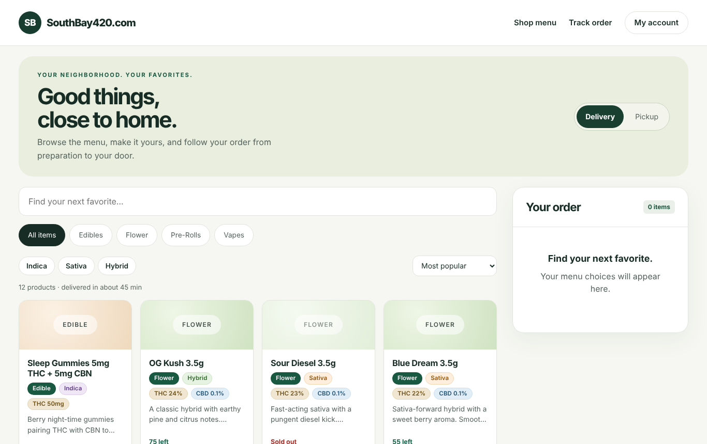
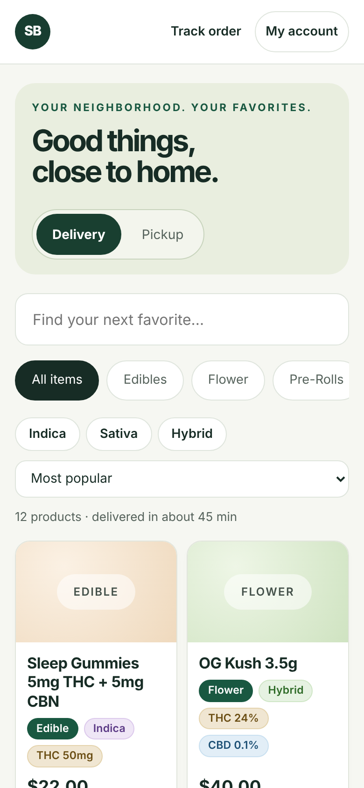

# SouthBay420 — a dispensary's ordering, register and loyalty, owned by the shop

**In short.** A full system for a licensed California cannabis retailer: online menu and ordering,
delivery tracking, customer accounts with loyalty, a staff console and an in-store register (POS). It
runs on the shop's own Cloudflare account and upgrades by uploading one ZIP, with no monthly POS vendor in
between. It began as a pizza-ordering template. Twenty-six releases later it's a dispensary system with
California compliance built in. It's deployed at southbay420.com but doesn't run a store yet; it's in
development toward the go-live bar I set for it.

| Releases | Automated tests | Database changes | Design decisions on record | Users                    |
| -------- | --------------- | ---------------- | -------------------------- | ------------------------ |
| 26       | 168             | 26 migrations    | 7 technical + 6 product    | None yet: in development |

## Screens

_Demo shop with sample data (no real customers or sales)._

| The register: member, points to redeem, "repeat last order", quick cash | The owner's console: today, the last 14 days, what needs attention |
| ----------------------------------------------------------------------- | ------------------------------------------------------------------ |
|                                |                   |
| **The online menu:** delivery or pickup, filters, live stock            | **On a phone**                                                     |
|                              |                  |

## The problem

Why build it at all? _"I have come to learn, I have a huge passion for building these products."_ It's an
exploration: _"I'm amazed at where it's at… I'm just enjoying the ride."_ I built it to production
standards so it could become a real product, but my store comes first. Pacific Wellness is moving to
Dutchie: _"Building it is different from ready to go live. I need the best now for the store."_

Who it serves, as jobs to be done (hypotheses to confirm):

- **Owner:** when I run a small dispensary, I want ordering, a register and loyalty I own and can change
  myself, so I'm not renting tools that don't fit my shop.
- **Budtender:** when there's a line, I want to check ID, find the member and ring the sale in seconds
  without breaking a California rule.
- **Customer:** when I order for pickup or delivery, I want to see what's really in stock and what deal I
  get, so there are no surprises at the counter.

## Constraints

- **No online card payments.** Card networks restrict cannabis, so customers pay at pickup or on delivery,
  and "card" at the register means a separate terminal.
- **California law, in the product.** Daily purchase limits by product kind and weight, with a live meter
  that locks Charge. ID checks. Edible potency caps. No "candy" names, no health claims, no advertising
  _free_ cannabis.
- **Metrc,** the state's track-and-trace system.
- **No marketing texts.** Carriers ban cannabis SMS, so texting stays off until there's a compliant
  provider.
- **Run by a non-developer.** Upgrades are one ZIP, the database updates itself, and every message is
  written for staff.

## Decisions

The product calls, each with options, a framework, my reasoning and a success signal:

1. **Every loyalty rule is a store setting.** The stores are the customers, so optionality is the rule,
   and Pacific Wellness's own ladder is the demo preset. _"The product is a portfolio piece for job
   interviews first, and the base of a company second."_
2. **"Stairway to Savings", not "Stairway to Freebies".** California bans advertising free cannabis goods
   (4 CCR §15040), and the rewards are discounts.
3. **Compliance: structure and cheap guardrails first.** Refuse what's clear-cut, warn on what needs
   judgment, and build the data model full enforcement will need.
4. **Metrc on its own branch,** so the product keeps shipping while slow, high-risk state reporting
   matures on a staging site.
5. **An AI harness, lean and fast, proven here first.** It's what lets me trust code I don't read.

Technical decisions behind it: a register sale is an order; rules that must survive two requests at once
(stock, points, the cash drawer) live in the database; a migration is frozen once shipped; every shipped
release becomes a test.

## What shipped

| When            | Releases   | Highlights                                                                                                               |
| --------------- | ---------- | ------------------------------------------------------------------------------------------------------------------------ |
| **[ask]** – Sep | 1.1.1–1.13 | From a pizza template to a dispensary: loyalty and referrals, age gate, POS, cash drawer, budtender PINs, member ID scan |
| Sep 24          | 1.14       | Moved into a repository with tests; backend split into modules; register rebuilt around a sale model                     |
| Sep 25          | 1.15–1.17  | Console redesign; separate addresses for shop, console and register; purchase limits, voids, end of day, timed sales     |
| Sep 28–30       | 1.18–1.20  | Deals, brands, receipts, owner alerts; two-step sign-in and abuse limits after an outside review                         |
| Oct 1–7         | 1.21–1.23  | Receiving and purchase orders; inventory redesign; structured product details, built names, compliance checks            |
| Oct 9–          | next       | Loyalty: a visit ladder whose reward grows each step. Research found no cannabis POS with an escalating ladder           |

## How it was built

I direct and decide; Claude writes the code. Quality comes from:

- tests on every change, including real-browser journeys;
- every shipped release kept as a test the next must pass;
- an outside security review, fixed in 1.19;
- a harness: hooks that refuse dangerous actions, an automatic finish-line check, and a second AI that
  reviews the first. On its first day the reviewer found 15 problems in the AI's own work; each was fixed
  with a test.

## Results

No store runs on it yet, by choice. My go-live criteria: months in the Metrc sandbox with no errors (or only
errors I can fix), and every feature at least as good as what's on the market. After launch, the number
I'd watch is stores running it.

## What I learned

**[ask]** Your three biggest lessons. Candidates from the record: compliance is a design input, not a
checklist; never break what's already out there; a non-developer can ship serious software when the
checks live outside the AI.

## Evidence

Private repository: product doc, build log, decision records, changelog and architecture docs, available
on request. Deployed: southbay420.com.
