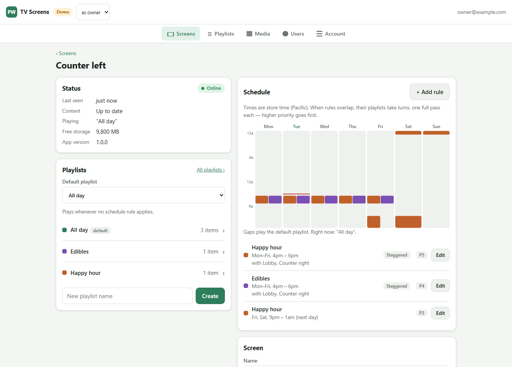
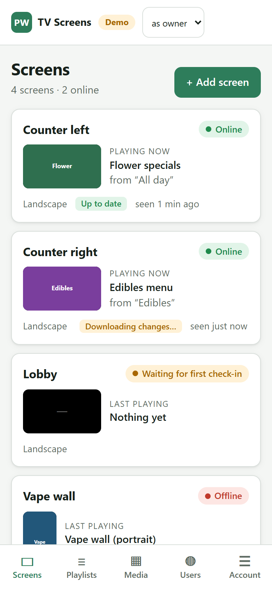

# Menu screens for my store's five TVs

**In short.** Pacific Wellness paid a menu-screen service $250 a month to run the five TVs in the store. On
October 9, 2026 I wrote a spec to replace it. By that afternoon there was a backend, an admin page and a
native Fire TV app. On October 12 all five TVs were running on it. The admin page runs from my phone.

## Screens

_The admin page in demo mode, with sample screens and playlists._

## The problem

The daily job is simple. Each TV plays the day's specials videos, and some play the same specials as their
neighbours. Under the old service every TV had its own playlists, so the same Monday specials got rebuilt
for each one. In my words at the time: _"I wanna be able to have playlists not tied only to a screen. If
I've built out a Tuesday playlist and I wanna assign it to multiple screens and have it scheduled, I wanna
do that."_

## Decisions

- **Overlapping schedules take turns.** My spec said the highest-priority rule wins. On the first TV I saw
  that was wrong for us: every matching playlist should play in turn, and priority only sets the order.
- **Neighbouring TVs stagger.** _"At any given time I don't want each TV to be playing the same thing
  (impossible if it's 2 specials and 3 TVs, but I'd like a 2/1 in that split)."_ Every TV in a staggered
  rule follows one shared clock and runs a step ahead of the one before it. A TV that reboots works out
  where it should be and rejoins.
- **One TV first.** The app went on one stick, ran in the store, then went to all five the same day.
- **The live POS menu waits.** A menu pulled live from the POS is in design. I've run those before and
  _"no one ever read them"_, so layouts get researched before they get built.

## How it was built

A Supabase database and storage, a phone-first admin page on Cloudflare Pages, and a native Kotlin app for
Fire TV that downloads everything before switching playlists and keeps playing offline. Claude Code wrote
the code. I wrote the spec, installed the sticks and tested it on the store's TVs.

## Evidence

Spec to first working build: about four hours, October 9, 2026. All five store TVs live October 12, 2026.
14 automated tests on the schedule and upload rules.
